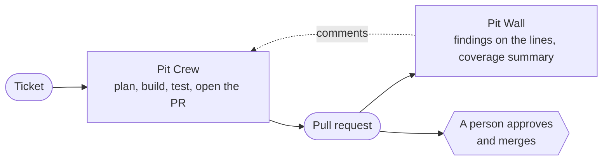

import { Card, CardGrid, LinkCard } from '@astrojs/starlight/components';

Paddock Agents is a family of agents that each own one stage of shipping a change. Each one runs on its own. Together they cover the path from a ticket to a merged pull request.

<CardGrid>
  <Card title="Pit Crew" icon="rocket">
    A feature delivery pipeline for Claude Code. You approve the business spec and the architecture at two gates; the agents implement, test, verify in DEV and open the pull requests with evidence.

    [Read the Pit Crew docs](pit-crew/)
  </Card>
  <Card title="Pit Wall" icon="magnifier">
    Agentic code review for GitHub pull requests. A GitHub App that leaves findings on the changed lines and a summary with the review's coverage. It works with any LLM provider behind one interface.

    [Read the Pit Wall docs](pit-wall/)
  </Card>
</CardGrid>

## Where each one sits

Pit Crew writes the change and opens the pull request. Pit Wall reviews it like any other pull request, no matter who wrote it. When both run on the same repository, Pit Crew waits for Pit Wall's review and resolves its comments before it hands the pull request back to you.

<LinkCard title="Use them together" description="Configure Pit Crew to wait for Pit Wall and resolve its findings." href="together/" />

## What they share

- **A person decides.** Pit Crew stops at two gates before any code exists and never deploys on its own. Pit Wall comments and never approves or requests changes.
- **Evidence over claims.** Pit Crew's pull requests carry what was tested and what was not. Pit Wall's summary says which files it reviewed and which it could not.
- **Your tools, not ours.** Pit Crew connects to your tracker, environments and logs through roles. Pit Wall reads your organisation's rules from rule packs in your repository.
