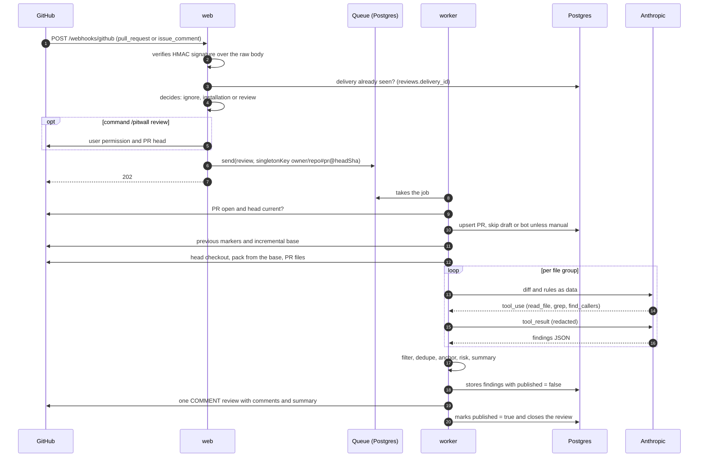

Pit Wall is a TypeScript monorepo (Node >= 22, ESM) that is built once and runs as two processes. This page describes how everything fits together. The reasoning behind each decision is in [`docs/decisions/`](../decisions/2026-11-19-initial-architecture/).

## Components

| Piece | Where | What it does |
|---|---|---|
| `web` | `packages/server/src/web.ts`, `app.ts` | Receives the webhook, verifies the signature, decides what to do and enqueues. Never reviews. Exposes `/healthz`. |
| `worker` | `packages/server/src/worker.ts` | Takes one job at a time from the queue, reviews the PR and publishes. |
| Queue | pg-boss in Postgres | `review` queue, one job per `owner/repo#pr@headSha` ([ADR 0002](../decisions/2026-11-19-queue-in-postgres-pg-boss/)). |
| `core` | `packages/core` | Review pipeline, GitHub, checkout, tools, packs, risk, redaction, publishing, database. |
| `eval` | `packages/eval` | Evaluation on the developer's machine. Not deployed ([evaluation.md](../evaluation/)). |
| Postgres | Railway | Data and queue. |
| GitHub App | github.com | Incoming webhook; outgoing API with an installation token ([github-app.md](../github-app/)). |
| Anthropic | api.anthropic.com | Model, through the Messages API ([ADR 0004](../decisions/2026-11-19-messages-api-no-strict-output/)). |
| Notion | api.notion.com | Optional: organization rules ([rule-packs.md](../rule-packs/)). |

Modules in `packages/core/src`:

| Module | Responsibility |
|---|---|
| `config` | Reads and validates environment variables; fails closed, naming the variable. |
| `github` | App client, PR data, file classification. |
| `checkout` | Shallow checkout of the head with hardened git. |
| `tools` | `read_file`, `grep`, `find_callers`, confined to the checkout. |
| `rulepack` | Schema, Notion, versions by hash, rendering as data. |
| `risk` | Deterministic risk score. |
| `finders` | Anthropic client, prompts, tool loop, parser. |
| `pipeline` | Groups files, runs the finders, filters, anchors, builds the summary. |
| `filters`, `anchor` | Fingerprint and dedupe; comment line derived from the quoted code. |
| `redact` | Secret redaction and logger. |
| `publish` | Job, state in the database, publishing to GitHub. |
| `db` | Pool and migrations. |

## Review flow

Step by step:

1. **Intake.** `web` verifies `X-Hub-Signature-256` over the raw body before parsing it. A bad signature returns `401`. A repeated delivery, an event of no interest or a command without permission returns `202` and does nothing.
2. **Decision** (`events.ts`, pure function). `pull_request` events with action `opened`, `reopened`, `synchronize` or `ready_for_review`; `issue_comment` created with `/pitwall review` ([ADR 0010](../decisions/2026-11-19-manual-trigger-pr-comment/)); `installation` for installs and uninstalls.
3. **Enqueueing.** The job carries `v: 1`, the installation, `owner/repo`, number, `headSha`, `deliveryId` and `manual` if it came from the command. If one with the same key already exists, the response is `duplicate`.
4. **Worker checks** (`publish/process.ts`). The job is discarded if the PR is no longer open, if the head moved or if that head was already reviewed (unless manual). A draft or a bot PR is skipped with a single notice per PR and reason, unless manual.
5. **Incremental base.** When it applies, only the PR files that changed since the last complete review are reviewed ([ADR 0009](../decisions/2026-11-19-incremental-review-semantics/)).
6. **Preparation.** The rule pack is read from the PR base ([ADR 0007](../decisions/2026-11-19-rule-packs-as-data/)), the files are listed and the head is cloned ([ADR 0006](../decisions/2026-11-19-head-checkout-confined-tools/)).
7. **Groups.** `groupFiles` groups files by directory and by relative JS/TS imports, up to 48,000 characters of diff per group. Every file lands in exactly one group. The budget is not a hard cap: a single file whose diff is over 48,000 characters gets a group of its own and is not split. A diff longer than 150,000 characters is cut at a hunk boundary and listed in the summary under "Revisados solo en parte" (partially reviewed).
8. **Finders.** One generalist finder runs per group; with `PITWALL_FINDERS=specialized` four run (security, correctness, performance, maintainability). Up to 3 runs in parallel. Each one is a loop of up to 8 model calls.
9. **Filters.** Anything with confidence below 0.6, duplicates by fingerprint and anything already published are discarded. Then `anchorByExistingCode` looks for the quoted code on the new side of the diff: with exactly one match there is an inline comment; with zero or several, the finding goes to the summary and a line is never guessed.
10. **Publishing.** Persist, publish one review and mark ([ADR 0008](../decisions/2026-11-19-dedupe-persist-publish-mark/)). Pit Wall always uses the `COMMENT` event: it never approves or requests changes.
11. **Retries.** If the model provider fails on part of the PR, the job is retried (3 retries, backoff starting at 30 s). On the last attempt whatever is available is published with an incomplete-review note.

## Data model

Nine tables, created by `migrations/20261119180000_initial-schema.sql`.

| Table | Purpose | Relevant keys and columns |
|---|---|---|
| `installations` | One installation of the App | unique `github_installation_id`, `account_login`, `account_type`, `deleted_at` (soft delete) |
| `repositories` | Repos of an installation | unique `github_repo_id`, `owner`, `name`, `default_branch` |
| `pull_requests` | PRs seen | unique `(repository_id, number)`; `head_sha`, `base_sha`, `draft`, `author_is_bot`, `state` |
| `reviews` | One review run | `status` (`queued`, `running`, `completed`, `failed`, `skipped`), `trigger`, `delivery_id`, `risk_score` jsonb (never null), `coverage` jsonb, `usage` jsonb, `pack_version_hash` |
| `findings` | Findings | unique `(pull_request_id, fingerprint)`; `file`, `line` (null: no line), `category`, `severity`, `confidence`, `rule_id`, `published`, `github_comment_id` |
| `rulepacks` | One pack per owner and name | unique `(owner, name)`; `source` (`notion` or `repo`), `synced_at` |
| `pack_versions` | Versions by hash | unique `(rulepack_id, content_hash)`; `content` jsonb |
| `eval_runs` | Evaluation runs | `suite`, `git_sha`, `config`, `metrics` |
| `eval_rows` | Rows per case | `outcome` (`tp`, `fp`, `fn`), `category`, `file`, `line`, `detail` |

Notes:

- A skipped review (`skipped`) also writes a row in `reviews`. Since `risk_score` does not allow null, it stores `{ "score": 0, "factors": [], "pending": true }` until there is a real score. Anyone consuming risk must read only `status = 'completed'`.
- `reviews.trigger` stores `webhook` both for the automatic trigger and for `/pitwall review`; `cli` is reserved.
- `eval_rows` grows without limit per run: every aggregation filters by `eval_run_id`.
- `github_comment_id` exists in the schema and the current code does not fill it.

## Risk score

`computeRisk` is deterministic, does not use the model and returns an integer from 0 to 100 with the factors that make it up. It is recorded in `reviews.risk_score`. **In deliverable 1 it does not change what is reviewed or how.** Each factor counts once, regardless of how many files trigger it.

| Factor | Weight |
|---|---|
| Size (changed lines): less than 50 / 200 / 500 / 1000 / more | 0 / 5 / 10 / 15 / 20 |
| `.sql` file | 10 |
| CI workflow (`.github/workflows/`) | 10 |
| `Dockerfile` or `docker-compose` | 5 |
| Dependency manifest (`package.json`, lockfile, `go.mod`, `pom.xml`, etc.) | 5 |
| `.env*` file | 10 |
| Pack path (`risk.paths`) | the pack's weight |
| Pack pattern (`risk.patterns`), over added lines of up to 2000 characters | the pack's weight |
| `pitwall:deep` label | 30 |

The total is capped at 100.

## Coverage

Each review states in the summary which part of the PR it looked at and which it did not (`Coverage`, stored in `reviews.coverage`):

- `totalFiles` and `reviewedFiles`, and how many groups there were.
- `notReviewed`, with a reason: `binary`, `patch_unavailable` (GitHub does not provide the diff), `deleted`, `rename_only`, `review_failed` (the group failed or was left incomplete).
- `fromContent`: files without a GitHub diff that were reviewed by reading the whole file from the checkout, as if it were all new.
- `partial`: files whose diff was cut because of size.
- `unlisted`: files left out by the GitHub API's cap of 3000.

A review with `review_failed` groups does not serve as the base for the next incremental review.

## Limits worth knowing

| Limit | Value | Where |
|---|---|---|
| Webhook body | 26 MiB | `app.ts` |
| Rule pack | 256 KiB, 500 rules | `pipeline/github.ts`, `rulepack/schema.ts` |
| Diff per file | 150,000 characters | `pipeline/review.ts` |
| Diff per group | 48,000 characters | `pipeline/group.ts` |
| Findings without a line in the summary | 30 | `pipeline/summary.ts` |
| Body of a GitHub review | 60,000 characters (GitHub's cap: 65,536) | `publish/github.ts` |
| File for `read_file` | 1 MiB, 64 KiB per read | `tools/index.ts` |
| Time of a job in the queue | 1 hour | `server/src/queue.ts` |
